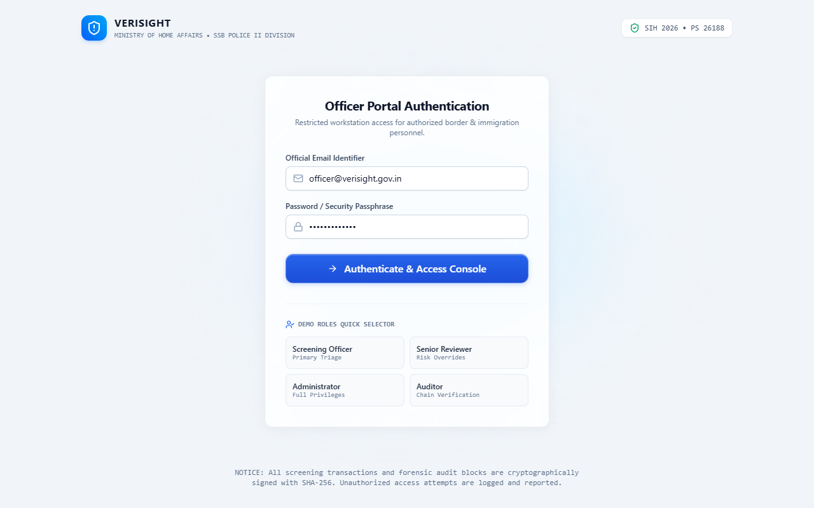

# VERISIGHT // AI-Based Identity & Document Screening Platform
### Smart India Hackathon 2026 // Problem Statement 26188
**Organization**: Ministry of Home Affairs — Sashastra Seema Bal (SSB), Police II Division  
**Theme**: Software // Blockchain & Cybersecurity  

---



## 1. Executive Summary

**VERISIGHT** is an enterprise-grade, privacy-preserving, explainable identity document screening platform engineered for authorized security officers, border control examiners, and institutional compliance auditors.

Designed from the ground up for high-throughput border checkpoints, consular posts, and law enforcement forensics, VERISIGHT replaces opaque black-box neural networks with **deterministic, mathematically verifiable decision support**:
1. **Pre-Flight Optical Quality**: Laplacian blur variance ($\ge 100$), specular glare ratio ($< 5\%$), mean luminance, and estimated DPI before analytical scoring.
2. **Preprocessing & Non-Destructive Ingestion**: Magic-byte validation, immediate SHA-256 evidence hashing, affine rotation, Hough line deskewing, and CLAHE contrast normalization.
3. **Pluggable OCR & Bounding Box Registry**: Tesseract CPU-optimized engine with normalized bounding box coordinates and reviewer correction workflows.
4. **ICAO Doc 9303 MRZ Engine**: Strict 7-3-1 weighted check digit verification on Document Number, DOB, Expiry, and Composite fields, plus automated Visual Inspection Zone (VIZ) cross-checks.
5. **Multi-Factor Digital Forensics Suite**:
   - **Error Level Analysis (ELA)**: Re-saved at JPEG quality 95 with JET colormap heatmap generation.
   - **Metadata & Provenance Inspection**: EXIF header analysis flagging Photoshop, Canva, GIMP, and Paint.NET signatures.
   - **Substrate Texture Variance**: High-frequency Laplacian noise analysis across spatial grids.
   - **Typographic Alignment**: Baseline linearity and angular pitch variance ($\Delta \theta$).
   - **Portrait Boundary Gradients**: Perimeter Sobel edge discontinuity analysis detecting photo-substitution seams.
6. **Explainable Risk Engine (`VERISIGHT-RULES-v1.2`)**: Three-tier classification (`CLEAR`, `REVIEW`, `HIGH_RISK`), separation of critical vs weak indicators, and anti-correlation de-duplication (*poor quality $\neq$ fraud*).
7. **Investigation Center**: Faceted case queue, multi-officer threaded notes, priority triage, and audited status transitions.
8. **Cryptographic SHA-256 Audit Chain**: Forward-secure, append-only hash-chained ledger storing every intake, field modification, risk override, and dossier export, with a live recursive integrity verification endpoint.
9. **Institutional 5-Page Dossier**: Automated ReportLab PDF generator containing credential metadata, quality metrics, extracted VIZ fields, MRZ checksums, forensic findings, and statutory non-conclusive disclaimers.
10. **Light Liquid Glass UI**: Modern enterprise security-operations interface with refraction optical mechanics, high-contrast WCAG AA readability, and fluid responsive design.

---

## 2. System Architecture & Tech Stack

```
VERISIGHT/
├── backend/
│   ├── app/
│   │   ├── api/v1/         # REST API routers (auth, screenings, forensics, risk, cases, reports, audit, admin)
│   │   ├── core/           # Config, database session, security, audit_chain
│   │   ├── engines/        # Quality, preprocessing, OCR, MRZ parser, forensics, risk, reports
│   │   ├── models/         # SQLAlchemy 11-table schema
│   │   └── schemas/        # Pydantic v2 validation DTOs
│   └── tests/              # Pytest test suite (26 comprehensive automated tests)
├── frontend/
│   ├── src/
│   │   ├── components/     # Light liquid glass panels, cards, inputs, modals, viewers
│   │   ├── context/        # AuthContext with auto-refresh JWT
│   │   ├── pages/          # 10 production application pages
│   │   └── services/       # Typed Axios API client modules
├── docs/                   # Full documentation suite (MASTER_SPEC, ARCHITECTURE, API, RISK_RULES, etc.)
├── scripts/                # Database seeding & synthetic evaluation scenario generator
├── demo_data/              # 5 pre-generated synthetic test scenarios
└── docker-compose.yml      # Multi-container production deployment specification
```

- **Frontend**: React 18, TypeScript 5, Vite, Tailwind CSS 3, Framer Motion, Recharts, Lucide Icons, TanStack Query, React Router v6.
- **Backend**: Python 3.11, FastAPI, Pydantic v2, SQLAlchemy 2, Alembic, Passlib (bcrypt), PyJWT.
- **Computer Vision & Forensics**: OpenCV, Pillow, NumPy, ReportLab 5.1, Tesseract OCR.
- **Database**: PostgreSQL (Docker) / SQLite (Local Dev).

---

## 3. Seeded Demonstration Credentials

| Role | Email | Password | Primary Capabilities |
| :--- | :--- | :--- | :--- |
| **Administrator** | `admin@verisight.gov.in` | `Admin@12345` | Full system governance, role configuration, engine health |
| **Screening Officer** | `officer@verisight.gov.in` | `Officer@12345` | Document intake, OCR correction, case triage |
| **Senior Reviewer** | `reviewer@verisight.gov.in` | `Reviewer@12345` | Forensic deep dive, supervisory risk override authority |
| **Compliance Auditor** | `auditor@verisight.gov.in` | `Auditor@12345` | Read-only ledger inspection, cryptographic chain validation |

---

## 4. Quick Start & Execution Guide

### Option A: Local Development Setup

#### 1. Backend Setup (Python 3.11)
```powershell
# Create and activate virtual environment
python -m venv backend/venv
.\backend\venv\Scripts\Activate.ps1

# Install dependencies
pip install -r backend/requirements.txt

# Seed demonstration accounts
python scripts/seed_database.py

# Generate 5 synthetic evaluation scenarios
python scripts/generate_synthetic_data.py

# Run FastAPI backend server
uvicorn backend.app.main:app --host 127.0.0.1 --port 8000 --reload
```

#### 2. Frontend Setup (Node.js & pnpm)
```powershell
cd frontend
pnpm install
pnpm run dev
```
Open **`http://127.0.0.1:5173`** in your browser.

---

### Option B: Docker Compose Deployment
```bash
docker compose up --build -d
```
- Frontend UI: `http://localhost:5173`
- Backend API Docs: `http://localhost:8000/docs`

---

## 5. Running Automated Tests

VERISIGHT includes 26 comprehensive automated tests covering Authentication, RBAC, Upload Validation, Quality Assessment, Preprocessing, OCR, MRZ Check Digits, Multi-Factor Forensics, Risk Engine Classification, Case Workflows, and Cryptographic SHA-256 Audit Integrity:

```powershell
backend\venv\Scripts\pytest.exe -v
```

Expected output:
```
======================= 26 passed, 2 warnings in 23.83s =======================
```

---

## 6. Pre-Generated Synthetic Evaluation Scenarios

Run `python scripts/generate_synthetic_data.py` to regenerate the 5 standardized evaluation scenarios in `demo_data/`:
1. `SCENARIO-1-CLEAN`: Genuine Indian passport with valid ICAO check digits and uniform ELA baseline &rarr; `CLEAR` (Score: 0.0).
2. `SCENARIO-2-EXPIRED`: Synthetic passport with expired validity period &rarr; `REVIEW` (Score: 35.0).
3. `SCENARIO-3-MRZ-MISMATCH`: Mismatched document numbers and invalid check digit &rarr; `HIGH_RISK` (Score: 90.0).
4. `SCENARIO-4-TAMPERED-ELA`: Spliced photo block with high ELA variance and Photoshop EXIF metadata &rarr; `HIGH_RISK` (Score: 45.0 + Critical Indicator).
5. `SCENARIO-5-LOW-QUALITY`: Severe motion blur and specular flash glare &rarr; `REVIEW` / Rescan Directive (Score: 35.0).

---

## 7. Documentation Suite

- [`docs/MASTER_SPEC.md`](docs/MASTER_SPEC.md): Authoritative system specification and functional requirements.
- [`docs/ARCHITECTURE.md`](docs/ARCHITECTURE.md): Deep-dive system architecture, data flows, and module decomposition.
- [`docs/API.md`](docs/API.md): Complete OpenAPI 3.1 endpoint reference manual.
- [`docs/RISK_RULES.md`](docs/RISK_RULES.md): Deterministic rules registry, weights, and anti-correlation axioms.
- [`docs/LIMITATIONS.md`](docs/LIMITATIONS.md): Technical boundaries, non-conclusive disclaimers, and DPDP 2023 privacy guarantees.
- [`docs/DEMO_SCRIPT.md`](docs/DEMO_SCRIPT.md): Step-by-step evaluation script for jury demonstrations.
- [`docs/JURY_QA.md`](docs/JURY_QA.md): Comprehensive defense Q&A covering adversarial AI, check digits, and forensics.
- [`docs/CHECKLIST.md`](docs/CHECKLIST.md): Verified acceptance checklist matrix.

---

## 8. Statutory & Evidentiary Disclaimer

> **STATUTORY NOTICE**: Error Level Analysis (ELA), frequency texture gradients, and automated OCR results provide decision-support indicators and probabilistic clues for trained immigration officers. They do NOT constitute autonomous legal proof of forgery or sovereign identity invalidity. Final clearance determinations are reserved exclusively for authorized border personnel.

