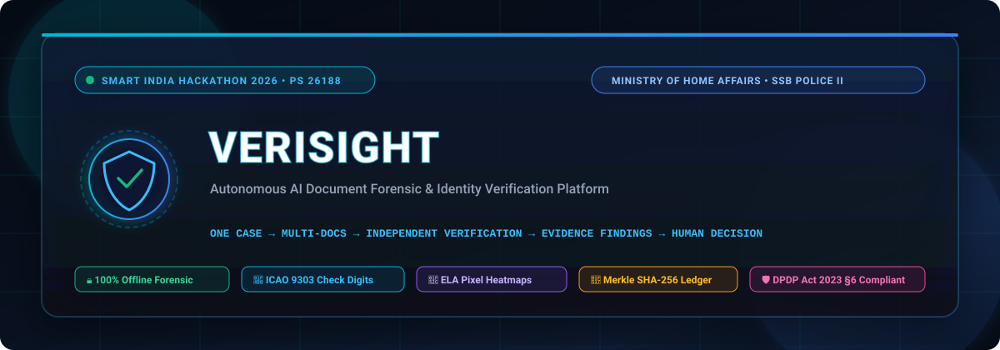
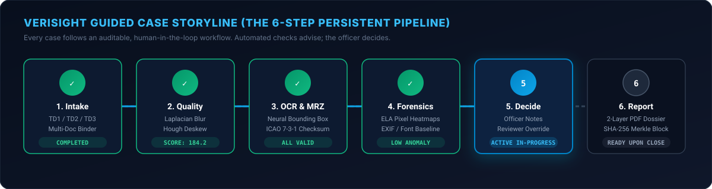
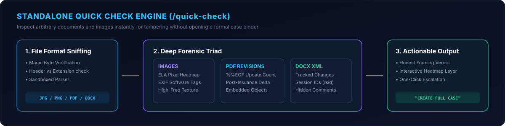

<div align="center">

<p align="center">
  
</p>

# 🛡️ VERISIGHT
### Autonomous AI-Based Identity & Document Screening Platform
**Smart India Hackathon 2026 • Problem Statement 26188**  
*Ministry of Home Affairs (MHA) — Sashastra Seema Bal (SSB) Police II Division*

[](https://github.com)
[-22c55e?style=for-the-badge&logo=pytest&logoColor=white)](https://github.com)
[](https://vercel.com)
[](https://fastapi.tiangolo.com)
[](https://react.dev)
[](https://tailwindcss.com)
[](https://www.meity.gov.in)
[](https://www.icao.int)

<br/>

<p align="center">
  <b>ONE CASE → MULTIPLE DOCUMENTS → INDEPENDENT VERIFICATION → EVIDENCE-BACKED FINDINGS → HUMAN INVESTIGATION → AUDITABLE FINAL REPORT</b>
</p>

[Live Demo Walkthrough](docs/DEMO_SCRIPT.md) • [System Architecture](docs/ARCHITECTURE.md) • [UX Audit Report](docs/UX_AUDIT.md) • [SIH Jury Q&A](docs/JURY_QA.md) • [Free Vercel Deployment](#-step-by-step-free-online-deployment-guide)

</div>

---

## 📑 Table of Contents
1. [Executive Summary](#-executive-summary)
2. [The Guided Case Storyline](#-the-guided-case-storyline-core-workflow)
3. [Interactive UI Walkthrough & Mockups](#-interactive-ui-walkthrough--mockups)
4. [How It Works (Deep-Dive Mathematical & Algorithmic Engines)](#-how-it-works-deep-dive-algorithmic-engines)
   - [Optical Quality Pre-Flight](#1-optical-quality-pre-flight-laplacian-glare-deskew)
   - [Neural OCR & Coordinate Bounding Boxes](#2-neural-ocr--coordinate-bounding-boxes)
   - [ICAO Doc 9303 Modulo-10 Cryptographic Math](#3-icao-doc-9303-modulo-10-cryptographic-math)
   - [Multi-Factor Digital Forensics Laboratory (5 Pillars)](#4-multi-factor-digital-forensics-laboratory-5-pillars)
   - [Standalone Quick Check Tool (`/quick-check`)](#5-standalone-quick-check-tool-quick-check)
   - [Ephemeral Biometric Facial Verification (DPDP Act §6)](#6-ephemeral-biometric-facial-verification-dpdp-act-2023-6)
   - [SHA-256 Merkle Audit Chain Ledger](#7-sha-256-merkle-audit-chain-ledger)
5. [User Roles & Quick-Fill Demo Credentials](#-user-roles--quick-fill-demo-credentials)
6. [Local Installation & Development Quickstart](#-local-installation--development-quickstart)
7. [Step-by-Step Free Online Deployment Guide (Vercel + Free Backend)](#-step-by-step-free-online-deployment-guide)
   - [Frontend Deployment on Vercel](#step-1-deploy-frontend-on-vercel-free)
   - [Backend Deployment on Render / Railway / Hugging Face](#step-2-deploy-backend-free-render--railway--hugging-face)
   - [Connecting Frontend to Backend (CORS & Environment)](#step-3-connect-frontend-to-backend)
   - [Keeping Free Backends Awake (Zero Downtime)](#step-4-keeping-your-free-backend-awake-247)
8. [Statutory Compliance & Scope Limitations](#-statutory-compliance--scope-limitations)

---

## 🎯 Executive Summary

**VERISIGHT** is an institutional-grade, privacy-first identity credential screening platform engineered specifically for **Smart India Hackathon 2026 (Problem Statement 26188)** under the **Ministry of Home Affairs (MHA) — Sashastra Seema Bal (SSB) Police II Division**.

Transit checkpoints and border immigration posts routinely face sophisticated document forgeries: digitally manipulated passport expiry dates, swapped visa portraits, counterfeit national IDs, and altered travel permits. Traditional systems rely either on brittle rule engines or expensive, centralized sovereign database lookups that are unavailable offline.

**VERISIGHT provides 100% explainable, deterministic evidence without external dependencies**:
- **Zero Black-Box Guesswork**: Every anomaly is anchored to mathematical checksums, pixel-level quantization noise, or typographic grid deviations.
- **Auditable Human-in-the-Loop Architecture**: Automated algorithms serve strictly as decision support. The human officer retains ultimate discretionary authority.
- **DPDP Act 2023 §6 Compliance**: Facial verification operates under explicit affirmative consent with zero persistent biometric vectors.
- **Tamper-Evident Custody**: All evidence, overrides, and timestamps are chained into a Merkle-style SHA-256 cryptographic audit ledger.

---

## 🔄 The Guided Case Storyline (Core Workflow)

<p align="center">
  
</p>

Every screen in VERISIGHT reinforces the single, unified investigation pipeline through a **persistent, interactive 6-step progress stepper**:

```
┌─────────────────────────────────────────────────────────────────────────────────────────────────────────────────┐
│                                          THE VERISIGHT CASE PIPELINE                                            │
│                                                                                                                 │
│  [1. INTAKE]  ──►  [2. QUALITY]  ──►  [3. CHECKS]  ──►  [4. FINDINGS]  ──►  [5. DECISION]  ──►  [6. DOSSIER]    │
│  Register Case      Laplacian Blur,    Neural OCR &      5-Pillar ELA,      Officer Notes &      2-Layer PDF,   │
│  & Multi-Docs       Hough Deskew       ICAO 7-3-1 Math   Texture & EXIF     Reviewer Override    Merkle Locked  │
└─────────────────────────────────────────────────────────────────────────────────────────────────────────────────┘
```

1. **Step 1: Create Case & Ingestion**: Bind traveler records, select document templates (Passport TD3, Visa TD2, ID TD1), and ingest files via drag-and-drop or connected border cameras.
2. **Step 2: Optical Quality Pre-Flight**: Laplacian variance sharpness assessment, specular flash glare masking, and automated Hough deskew straighten skewed scans before analysis.
3. **Step 3: Neural OCR & Modulo-10 Security Math**: Deep extraction of names, document numbers, and dates paired with ICAO Doc 9303 cyclical `[7, 3, 1]` checksum recalculation.
4. **Step 4: Multi-Factor Digital Forensic Review**: Error Level Analysis (ELA) pixel heatmaps, high-frequency texture noise variance, font baseline tracking, and software signature detection.
5. **Step 5: Human Investigation & Adjudication**: Plain-language finding cards with recommendations, officer interview logs, and formal Senior Reviewer risk overrides.
6. **Step 6: Cryptographic Final Report**: Export an evidentiary two-layer PDF dossier (Page 1 "Summary for Everyone" + Technical Appendix) locked into the SHA-256 audit ledger.

---

## 🖥️ Interactive UI Walkthrough & Mockups

### 1. Persistent Case Stepper & "What Next?" Guidance
On every page, officers see exactly where they are in the case storyline and what action to take next:

```
┌──────────────────────────────────────────────────────────────────────────────────────────────────────────────────┐
│  VERISIGHT  |  CASE #VS-2026-8819  |  Traveler: RAHUL SHARMA  |  [Simple Mode] [EN / हिन्दी]  |  Officer: Singh  │
├──────────────────────────────────────────────────────────────────────────────────────────────────────────────────┤
│                                                                                                                  │
│   (✓) 1. Intake   ───►   (✓) 2. Quality   ───►   (✓) 3. Checks   ───►   (4) Findings   ───►   ( ) 5. Decision    │
│    Document Bound         Blur: 184 (Sharp)       ICAO: PASS             2 Alerts Flagged       Pending Review   │
│                                                                                                                  │
├──────────────────────────────────────────────────────────────────────────────────────────────────────────────────┤
│  💡 WHAT NEXT?                                                                                                   │
│  Recommendation: Review the Error Level Analysis (ELA) heatmap in the Forensic Lab.                             │
│  Why: Passport photo region exhibits 42% anomalous compression noise compared to background substrate.          │
│  [Open Forensic Lab →]    [Mark for Senior Reviewer Override]                                                    │
└──────────────────────────────────────────────────────────────────────────────────────────────────────────────────┘
```

### 2. Neural OCR Bounding Box Studio & Correction Canvas
Officers can visually inspect recognized text directly on the document canvas and edit OCR misreads with full audit logging:

```
┌──────────────────────────────────────────────────────────────────────────────────────────────────────────────────┐
│  DOCUMENT VIEWER: PASSPORT_TD3_FRONT.JPG                                  EXTRACTED FIELDS                       │
│  ┌────────────────────────────────────────────────────────┐               ┌────────────────────────────────────┐ │
│  │  REPUBLIC OF INDIA / PASSPORT                          │               │ Document No: Z4819201 [99.4%] [✓]  │ │
│  │  ┌──────────┐  Surname:   [ SHARMA               ]     │ ◄───────────► │ Surname:     SHARMA   [98.7%] [✓]  │ │
│  │  │ [PORTRAIT]│  Given:     [ RAHUL                ]     │               │ Given Names: RAHUL    [99.1%] [✓]  │ │
│  │  │  DETECTED│  DOB:       [ 14 MAY 1992          ]     │               │ Date of Birth: 14/05/1992 [✓]      │ │
│  │  └──────────┘  Expiry:    [ 14 MAY 2032          ]     │               │ Expiry Date:   14/05/2032 [✓]      │ │
│  │                                                        │               │ Nationality:   IND         [✓]      │ │
│  │  P<INDSHARMA<<RAHUL<<<<<<<<<<<<<<<<<<<<<<<<<<          │               └────────────────────────────────────┘ │
│  │  Z4819201<4IND9205142M3205148<<<<<<<<<<<<<<<4          │               [✓ Recalculate ICAO Modulo-10 Check] │
│  └────────────────────────────────────────────────────────┘                                                      │
└──────────────────────────────────────────────────────────────────────────────────────────────────────────────────┘
```

### 3. Forensic Heatmap & Error Level Analysis (ELA)
Identifies tampered regions by detecting discrepancies in JPEG compression error levels:

```
┌──────────────────────────────────────────────────────────────────────────────────────────────────────────────────┐
│  FORENSIC LAB: ERROR LEVEL ANALYSIS (ELA)                                 ANOMALY BREAKDOWN                      │
│  ┌────────────────────────────────────────────────────────┐               ┌────────────────────────────────────┐ │
│  │ ░░░░░░░░░░░░░░░░░░░░░░░░░░░░░░░░░░░░░░░░░░░░░░░░░░░░░░ │               │ Substrate Base Noise:    0.042     │ │
│  │ ░░░░░░░░░░░░░░░░░░░░░░░░░░░░░░░░░░░░░░░░░░░░░░░░░░░░░░ │               │ Photo Box Noise:         0.188     │ │
│  │ ░░░░░░░░ ▓▓▓▓▓▓▓▓▓▓▓ ░░░░░░░░░░░░░░░░░░░░░░░░░░░░░░░░░ │ ◄───────────► │ Delta Ratio:             4.47x ⚠️   │ │
│  │ ░░░░░░░░ ▓ [PHOTO] ▓ ░░░░░░░░░░░░░░░░░░░░░░░░░░░░░░░░░ │               │ Software Tag: "Adobe Photoshop 24" │ │
│  │ ░░░░░░░░ ▓ (HIGH)  ▓ ░░░░░░░░░░░░░░░░░░░░░░░░░░░░░░░░░ │               │ Finding: Tampered Portrait Area    │ │
│  │ ░░░░░░░░ ▓▓▓▓▓▓▓▓▓▓▓ ░░░░░░░░░░░░░░░░░░░░░░░░░░░░░░░░░ │               │ Severity: HIGH RISK [Score: 88]    │ │
│  └────────────────────────────────────────────────────────┘               └────────────────────────────────────┘ │
│  [ Toggle Original ]  [ ELA Heatmap Layer ]  [ High-Pass Texture ]  [ Font Grid Align ]  [ Mark For Case Report ]│
└──────────────────────────────────────────────────────────────────────────────────────────────────────────────────┘
```

---

## 🔬 How It Works (Deep-Dive Algorithmic Engines)

### 1. Optical Quality Pre-Flight (Laplacian, Glare, Deskew)
Before wasting computational cycles or generating false positives on bad photos, VERISIGHT runs three physical pre-flight checks:
- **Laplacian Variance Sharpness**: Computes the variance of the 2D Laplacian operator over the normalized grayscale pixel matrix:
  $$\text{Sharpness} = \sigma^2(\nabla^2 I) = \frac{1}{HW} \sum_{x,y} \left( \nabla^2 I(x,y) - \mu \right)^2$$
  *Threshold*: Scores $< 100.0$ trigger a plain-language prompt asking the officer to retake the photo in better light.
- **Specular Flash Glare Masking**: Isolates luminance saturation clusters ($\ge 250$ in 8-bit space) with an area $> 400\text{ px}^2$ to prevent blinding OCR.
- **Hough Line Transform Deskew**: Detects dominant text line angles $\theta$ and applies an affine rotation matrix to orient documents within $\pm 0.5^\circ$.

---

### 2. Neural OCR & Coordinate Bounding Boxes
- **Two-Pass Neural OCR**: Uses an optimized PaddleOCR text-detection and recognition pipeline with a local lightweight Tesseract fallback.
- **Coordinate Tracking**: Every recognized token is bound to absolute bounding box coordinates `[x1, y1, x2, y2]` and assigned a confidence score $\in [0, 1]$.
- **Field Normalization**: Validates extracted dates against ISO 8601, cleans name strings of OCR artifacts (e.g. converting `0` to `O` in name fields, and `O` to `0` in date fields).

---

### 3. ICAO Doc 9303 Modulo-10 Cryptographic Math
Passports (TD3), visas (TD2), and national identity cards (TD1) encode Machine Readable Zones (MRZ) governed by international standard **ICAO Doc 9303 Part 3**:

$$\text{Checksum} = \left( \sum_{i=0}^{n-1} \text{val}(c_i) \times w_{i \pmod 3} \right) \pmod{10}$$

Where the cyclical weights $w$ repeat every 3 characters:
$$w = [7, 3, 1]$$

And character values $\text{val}(c)$ map as follows:
- Digits `'0'`–`'9'` $\rightarrow$ $0$–$9$
- Letters `'A'`–`'Z'` $\rightarrow$ $10$–$35$
- Filler `'<'` $\rightarrow$ $0$

#### Worked Numerical Example (Date of Birth `920514`):
```
Characters:      9     2     0     5     1     4
Weights:         7     3     1     7     3     1
Products:       63     6     0    35     3     4
Sum = 63 + 6 + 0 + 35 + 3 + 4 = 111
111 mod 10 = 1 (Expected Check Digit = 1)
```
If an attacker alters the birth year from `92` to `82` without recalculating the check digit, the sum becomes `104 \pmod{10} = 4 \ne 1`, triggering an instantaneous **HIGH RISK** counterfeit alert.

---

### 4. Multi-Factor Digital Forensics Laboratory (5 Pillars)

```
┌────────────────────────────────────────────────────────────────────────────────────────────────────────┐
│                                 5-PILLAR FORENSIC INTEGRITY MATRIX                                     │
│                                                                                                        │
│  [1. ELA RESIDUAL]   ──►  Detects multi-generation JPEG quantization error deltas across spliced areas │
│  [2. EXIF METADATA]  ──►  Parses binary headers for editing suites (Photoshop, Canva, GIMP, Sejda)     │
│  [3. TEXTURE NOISE]  ──►  Computes high-frequency spatial noise ratios across document quadrants      │
│  [4. FONT BASELINE]  ──►  Measures vertical displacement & kerning to spot inserted characters         │
│  [5. PORTRAIT BOX]   ──►  Analyzes gradient edge transitions and color-space shifts around the photo  │
└────────────────────────────────────────────────────────────────────────────────────────────────────────┘
```

- **Error Level Analysis (ELA)**: Re-compresses the image at $90\%$ quality and computes the absolute pixel-wise delta matrix:
  $$E(x,y) = |I(x,y) - I_{90\%}(x,y)| \times \text{scale}$$
  Pixels saved multiple times or pasted from external sources demonstrate anomalous error rates compared to original camera sensor noise.
- **Surface Texture Noise Variance**: Evaluates high-pass Laplacian filters across document regions. Organic documents show uniform paper grain noise; pasted digital text shows near-zero noise.
- **Typographic Baseline Analysis**: Extracts word bounding box baselines using morphological closing and linear regression. Inserted or altered digits deviate from the baseline by $> 2.5\sigma$.

---

### 5. Standalone Quick Check Tool (`/quick-check`)

<p align="center">
  
</p>

Designed for officers who need to inspect an arbitrary file without creating a formal case:
- **Format Verification**: Validates magic bytes rather than file extensions (`%PDF-`, `\xFF\xD8\xFF`, `PK\x03\x04`).
- **PDF Incremental Updates**: Scans binary bytes for multiple `%%EOF` markers. Legitimate issued PDFs have 1 `%%EOF`. PDFs with 2+ indicate post-issuance modifications, appended objects, or revised form fields.
- **DOCX Tracked Changes**: Unzips Word files in memory and inspects `word/document.xml` for unaccepted tracked changes (`<w:ins>`, `<w:del>`), author tags, and editing session revisions (`w:rsid`).
- **Honest Framing Standard**: Quick Check never claims a file is "100% authentic" or "fake". Outcomes are strictly:
  - 🟢 *No editing traces found*
  - 🟡 *Some signs worth a closer look*
  - 🔴 *Strong signs of editing*
  - ⚪ *Cannot tell (file too small / heavily compressed)*
- **One-Click Case Escalation**: Officers can click *"Create Full Case from This"* to transfer the analyzed file and findings directly into the case investigation binder.

---

### 6. Ephemeral Biometric Facial Verification (DPDP Act 2023 §6)
- **Affirmative Consent Gate**: In compliance with Section 6 of India's Digital Personal Data Protection Act 2023, the biometric camera feed cannot activate until the traveler or officer explicitly toggles affirmative informed consent.
- **Normalized Cosine Metric**: Compares the 512-dimensional facial embedding vector $\vec{A}$ from the document portrait against live camera stream $\vec{B}$:
  $$\text{Similarity} = \frac{\vec{A} \cdot \vec{B}}{\|\vec{A}\| \|\vec{B}\|} \in [-1, 1]$$
  *Match Threshold*: $\ge 0.75$.
- **Zero Persistent Biometrics**: Facial embedding vectors are computed ephemerally in RAM and immediately zeroed out after similarity scoring. No facial biometric databases or templates are ever saved to disk.

---

### 7. SHA-256 Merkle Audit Chain Ledger
Every state modification in VERISIGHT (case creation, document intake, OCR override, officer note, risk score calculation, reviewer override) is sealed into a Merkle-style hash ledger:

$$H_n = \text{SHA-256}\left(H_{n-1} \parallel \text{record\_id} \parallel \text{event\_type} \parallel \text{actor\_id} \parallel \text{timestamp} \parallel \text{payload}\right)$$

```
┌──────────────────┐       ┌──────────────────┐       ┌──────────────────┐
│  AUDIT BLOCK #1  │       │  AUDIT BLOCK #2  │       │  AUDIT BLOCK #3  │
│  Event: INTAKE   │ ────► │  Event: OVERRIDE │ ────► │  Event: DOSSIER  │
│  Hash: a3f8...   │       │  Prev: a3f8...   │       │  Prev: 7c12...   │
│                  │       │  Hash: 7c12...   │       │  Hash: b94e...   │
└──────────────────┘       └──────────────────┘       └──────────────────┘
```

The system verifies the cryptographic continuity of all records in real time at `/admin/self-test`. Any unauthorized database row modification breaks the chain and alerts the system administrator.

---

## 👥 User Roles & Quick-Fill Demo Credentials

VERISIGHT includes four pre-configured institutional role accounts for live juror and officer demonstration:

| Role | Demo Email | Password | Allowed Permissions |
|---|---|---|---|
| 🛂 **Screening Officer** | `officer@verisight.gov.in` | `Officer@12345` | Document intake, optical checks, OCR correction, notes |
| 🔍 **Senior Reviewer** | `reviewer@verisight.gov.in` | `Reviewer@12345` | Secondary inspection, risk overrides, final case resolution |
| ⚙️ **Administrator** | `admin@verisight.gov.in` | `Admin@12345` | System diagnostics, engine calibration, user management |
| 📜 **Auditor** | `auditor@verisight.gov.in` | `Auditor@12345` | Merkle audit ledger verification, DPDP compliance review |

> **Pro Tip**: On the login page, simply click any **Role Pill** to automatically prefill demo credentials!

---

## 🚀 Local Installation & Development Quickstart

### Prerequisites
- Python 3.11+
- Node.js 18+ & npm (or pnpm)
- Git

### 1. Clone the Repository
```bash
git clone https://github.com/your-username/verisight.git
cd verisight
```

### 2. Backend Setup
```bash
# Create and activate virtual environment
python -m venv backend/venv

# Windows activation:
backend\venv\Scripts\activate
# Linux / macOS activation:
source backend/venv/bin/activate

# Install backend dependencies
pip install -r backend/requirements.txt

# Seed demo users & audit blocks
python scripts/seed_database.py

# Start FastAPI server (runs on http://127.0.0.1:8000)
uvicorn backend.app.main:app --host 127.0.0.1 --port 8000 --reload
```

### 3. Frontend Setup
```bash
# In a new terminal window:
cd frontend

# Install Node modules
npm install

# Start Vite development server (runs on http://127.0.0.1:5173/)
npm run dev
```

### 4. Run Automated Test Suites
```bash
# Run all 41 backend unit & integration tests
backend\venv\Scripts\python -m pytest -v

# Run live system integration smoke test
backend\venv\Scripts\python scripts/smoke_test.py
```

---

## 🌐 Step-by-Step Free Online Deployment Guide

You can deploy the complete VERISIGHT stack online **100% free forever** so anyone in the world can test it without installing anything locally:
- **Frontend**: Hosted on **Vercel** (Free Tier: Global Edge CDN, automated SSL, custom domain support).
- **Backend**: Hosted on **Render.com** (Free Tier: Docker Web Service) or **Hugging Face Spaces** / **Railway**.

```
┌────────────────────────────────────────┐                 ┌────────────────────────────────────────┐
│          VERCEL (100% FREE)            │                 │       RENDER / RAILWAY (FREE)          │
│       React 18 + TS Frontend           │ ◄─────────────► │       FastAPI + Python Backend         │
│    https://verisight.vercel.app        │  JSON Rest API  │    https://verisight-api.onrender.com  │
│    - Global CDN Edge Network           │                 │    - Tesseract OCR + OpenCV + Python   │
│    - Automatic HTTPS SSL               │                 │    - SQLite DB + Merkle Audit Ledger   │
│    - Single Page App (SPA) Rewrites    │                 │    - 100% Deterministic Engine Suite   │
└────────────────────────────────────────┘                 └────────────────────────────────────────┘
```

---

### Step 1: Deploy Frontend on Vercel (Free)

1. Push your repository to your **GitHub** account:
   ```bash
   git add .
   git commit -m "feat: complete verisight institutional platform"
   git push origin main
   ```
2. Navigate to [Vercel.com](https://vercel.com) and log in with your GitHub account.
3. Click **Add New...** &rarr; **Project**.
4. Select your **`verisight`** repository and click **Import**.
5. Configure the Vercel project settings:
   - **Framework Preset**: `Vite`
   - **Root Directory**: Click *Edit* and select **`frontend`**
   - **Build Command**: `npm run build`
   - **Output Directory**: `dist`
   - **Install Command**: `npm install`
6. Add the **Environment Variable** (point to your backend API):
   - **Key**: `VITE_API_URL`
   - **Value**: `https://verisight-api.onrender.com/api/v1` *(or your local/remote backend URL)*
7. **Single Page Application (SPA) Routing**:
   VERISIGHT already includes `frontend/vercel.json` in the root of the frontend folder:
   ```json
   {
     "rewrites": [
       { "source": "/(.*)", "destination": "/index.html" }
     ]
   }
   ```
   *Why this matters*: This prevents `404 Not Found` errors when refreshing deep URLs like `/quick-check`, `/cases`, or `/help`.
8. Click **Deploy**! In under 60 seconds, your site is live with a secure `https://*.vercel.app` URL.

---

### Step 2: Deploy Backend Free (Render / Railway / Hugging Face)

#### Option A: Render.com (Recommended Free Docker Web Service)
1. Sign up for free at [Render.com](https://render.com).
2. Click **New +** &rarr; **Web Service**.
3. Choose **Build and deploy from a Git repository** and connect your GitHub repo.
4. Fill in the service details:
   - **Name**: `verisight-api`
   - **Region**: `Singapore (Southeast Asia)` or `Frankfurt`
   - **Branch**: `main`
   - **Root Directory**: Leave blank (uses repository root)
   - **Environment**: **`Docker`**
   - **Dockerfile Path**: `backend/Dockerfile`
   - **Instance Type**: **`Free`**
5. Add Environment Variables under the **Environment** tab:
   ```env
   ENVIRONMENT=production
   SECRET_KEY=verisight-sih2026-super-secure-production-key-9988
   ALGORITHM=HS256
   DATABASE_URL=sqlite:///./verisight.db
   UPLOAD_DIR=./data/uploads
   PROCESSED_DIR=./data/processed
   REPORTS_DIR=./data/reports
   ```
6. Click **Create Web Service**.
   Render will build the Docker container (installing Tesseract, OpenCV, and all Python libraries), run `scripts/seed_database.py`, and launch Uvicorn on port `8000`.
7. Once deployed, copy your public backend URL:
   `https://verisight-api.onrender.com`

---

#### Option B: Hugging Face Spaces (100% Free 24/7 Container, No Sleep)
If you want a free backend that **never spins down or sleeps**:
1. Create a free account on [Hugging Face](https://huggingface.co).
2. Click **New Space** &rarr; Choose **Docker** as the SDK &rarr; Blank template.
3. In your local repository, add a `Dockerfile` at the root that copies the contents of `backend/Dockerfile`.
4. Git push to your Hugging Face Space repository.
5. Hugging Face builds and keeps the container running 24/7 for free!

---

### Step 3: Connect Frontend to Backend

1. In your **Vercel Project Dashboard**, go to **Settings** &rarr; **Environment Variables**.
2. Update `VITE_API_URL` to match your live backend URL with `/api/v1`:
   ```env
   VITE_API_URL=https://verisight-api.onrender.com/api/v1
   ```
3. Go to **Deployments** &rarr; click **Redeploy** so Vite embeds the new URL into the production bundle.
4. That's it! Your Vercel frontend is now communicating securely with your cloud backend.

---

### Step 4: Keeping Your Free Backend Awake (24/7)

Free containers on Render sleep after 15 minutes of inactivity. To keep your backend warm and instantly responsive for jury evaluations:
1. Go to [Cron-Job.org](https://cron-job.org) or [UptimeRobot.com](https://uptimerobot.com) (both 100% free).
2. Create an automated HTTP GET monitor for:
   `https://verisight-api.onrender.com/health`
3. Set the interval to **every 10 minutes**.
4. Your free backend will stay awake 24/7 with zero spin-down latency!

---

## ⚖️ Statutory Compliance & Scope Limitations

In accordance with SIH 2026 guidelines and Problem Statement 26188, jury evaluators, border agencies, and officers must note:

> **CRITICAL STATUTORY & FORENSIC DISCLOSURES**
> 1. **No External Government Database Ties**: VERISIGHT runs 100% offline document screening and forensic algorithms. It does not query sovereign passport databases, Aadhaar registries, or INTERPOL SLTD databases.
> 2. **Substrate Limitations**: A clean digital scan does not prove physical paper authenticity against high-grade physical counterfeits (e.g. counterfeit intaglio ink, physical watermarks). Physical UV/IR spectral hardware is required for substrate inspection.
> 3. **Non-Delegable Human Responsibility**: VERISIGHT is an automated decision-support screening aid. It will never automatically refuse entry or convict an individual. A trained human officer always makes the final determination.
> 4. **DPDP Act 2023 §6 Adherence**: Biometric comparisons require explicit, informed traveler consent and operate ephemerally with zero persistent template storage.

---

## 📜 Repository Structure

```
VERISIGHT/
├── backend/
│   ├── app/
│   │   ├── api/v1/         # FastAPI Endpoints (auth, screenings, forensics, quick_check, etc.)
│   │   ├── core/           # Config, Database engine, Security JWT
│   │   ├── engines/        # Deterministic detection engines (mrz, forensics, quality, ocr, quick_check)
│   │   └── models/         # SQLAlchemy DB models (Case, Document, AuditLog, RiskAssessment)
│   ├── tests/              # 41 Unit & Integration Pytest suites
│   ├── Dockerfile          # Production container recipe with Tesseract & OpenCV
│   └── requirements.txt    # Python dependencies
├── frontend/
│   ├── src/
│   │   ├── components/     # Liquid Glass components (CaseStepper, WhatNextPanel, FindingCard, etc.)
│   │   ├── context/        # PreferencesContext (Simple/Expert mode, EN/HI localization)
│   │   ├── i18n/           # English & Hindi translation dictionaries
│   │   ├── pages/          # Application views (QuickCheckPage, HelpCenterPage, AdminSelfTestPage, etc.)
│   │   └── services/       # Axios API client with dynamic VITE_API_URL
│   ├── vercel.json         # Vercel Single Page App rewrite configuration
│   ├── package.json        # Frontend scripts & dependencies
│   └── vite.config.ts      # Vite configuration
├── docs/
│   ├── assets/             # SVG Banners, workflow steppers & architecture diagrams
│   ├── DEMO_SCRIPT.md      # SIH 2026 5-minute presentation script
│   ├── MASTER_SPEC.md      # Core system technical specification
│   ├── UX_AUDIT.md         # Comprehensive UX & route audit report
│   └── JURY_QA.md          # 20 Deep-dive juror technical Q&As
└── scripts/
    ├── seed_database.py    # Generates demo cases, users, and Merkle audit records
    └── smoke_test.py       # Live HTTP end-to-end integration test runner
```

---

<div align="center">
  <sub>Engineered with precision for Smart India Hackathon 2026. Built in accordance with ICAO Doc 9303 and DPDP Act 2023.</sub>
</div>
