<div align="center">

# 🛡️ VERISIGHT
### AI-Based Autonomous Identity & Document Screening Platform
**Smart India Hackathon 2026 • Problem Statement 26188**  
*Ministry of Home Affairs (MHA) — Sashastra Seema Bal (SSB) Police II Division*

[](https://github.com)
[-22c55e?style=for-the-badge&logo=pytest&logoColor=white)](https://github.com)
[](https://react.dev)
[](https://fastapi.tiangolo.com)
[](https://tailwindcss.com)
[](https://www.meity.gov.in)

<p align="center">
  <b>ONE CASE → MULTIPLE DOCUMENTS → INDEPENDENT VERIFICATION → EVIDENCE-BACKED FINDINGS → HUMAN INVESTIGATION → AUDITABLE FINAL REPORT</b>
</p>

[Explore Documentation](docs/MASTER_SPEC.md) • [UX Audit Report](docs/UX_AUDIT.md) • [Demo Script](docs/DEMO_SCRIPT.md) • [Deploy on Vercel](#-free-cloud-deployment-guide)

</div>

---

## 📑 Table of Contents
- [Executive Overview](#-executive-overview)
- [The Guided Case Story (Core Workflow)](#-the-guided-case-story-core-workflow)
- [System Architecture](#-system-architecture)
- [Core Detection & Forensic Engines](#-core-detection--forensic-engines)
  - [1. Optical Quality Pre-Flight](#1-optical-quality-pre-flight)
  - [2. Neural OCR & Bounding Boxes](#2-neural-ocr--bounding-boxes)
  - [3. ICAO Doc 9303 MRZ Cryptographic Math](#3-icao-doc-9303-mrz-cryptographic-math)
  - [4. Multi-Factor Digital Forensic Laboratory](#4-multi-factor-digital-forensic-laboratory)
  - [5. Standalone Quick Check Tool](#5-standalone-quick-check-tool)
  - [6. Ephemeral Biometric Facial Verification](#6-ephemeral-biometric-facial-verification)
  - [7. SHA-256 Merkle Audit Ledger](#7-sha-256-merkle-audit-ledger)
- [User Experience & Accessibility (Anti-Slop Standard)](#-user-experience--accessibility-anti-slop-standard)
- [User Roles & Demo Credentials](#-user-roles--demo-credentials)
- [Local Installation & Quickstart](#-local-installation--quickstart)
- [Free Cloud Deployment Guide (Vercel + Free Backend)](#-free-cloud-deployment-guide)
- [Statutory Compliance & Scope Limitations](#-statutory-compliance--scope-limitations)

---

## 🎯 Executive Overview

**VERISIGHT** is an institutional-grade, privacy-first identity credential screening platform built for border control points, immigration desks, and law enforcement agencies. Engineered specifically for **Smart India Hackathon 2026 (Problem Statement 26188)**, the system solves the critical vulnerability of fraudulent identity credentials (forged passports, tampered visas, counterfeit national IDs) being presented at transit checkpoints.

Unlike commercial black-box models, VERISIGHT provides **100% explainable, deterministic evidence** without requiring internet access or querying sovereign databases. Every finding is anchored to pixel-level computer vision metrics, typographic baselines, JPEG compression quantization blocks, and cryptographic checksums.

```
┌────────────────────────────────────────────────────────────────────────────────────────────────────────┐
│                                   THE 6-STEP VERIFICATION STORY                                        │
│                                                                                                        │
│  [1. INTAKE]  ──►  [2. QUALITY]  ──►  [3. CHECKS]  ──►  [4. FINDINGS]  ──►  [5. DECISION]  ──► [6. REPORT]  │
│  Reference &      Laplacian Blur &     OCR Bounding      ELA Heatmap,        Officer Notes &     SHA-256 Signed │
│  Template Type    Skew Correction      MRZ Check Digits  Texture & EXIF      Reviewer Override   PDF Dossier    │
└────────────────────────────────────────────────────────────────────────────────────────────────────────┘
```

---

## 🔄 The Guided Case Story (Core Workflow)

VERISIGHT replaces confusing disconnected menus with a **persistent, clickable 6-step progress stepper** on every screen:

1. **Step 1: Create Case & Ingestion**: Select credential template (Passport TD3, Visa TD2, National ID TD1), attach traveler metadata, and intake images via drag-and-drop or border webcams.
2. **Step 2: Optical Quality Pre-Flight**: Laplacian variance sharpness assessment, specular glare detection, and Hough Transform deskew to eliminate poor-lighting false alarms.
3. **Step 3: Automated Extraction & Security Math**: PaddleOCR character extraction with visual bounding boxes, coupled with ICAO Doc 9303 modulo-10 checksum validation with cyclical weights `[7, 3, 1]`.
4. **Step 4: Multi-Factor Forensic Review**: Error Level Analysis (ELA) heatmaps, high-frequency texture noise variances, typographic alignment analysis, and software artifact scanning.
5. **Step 5: Investigate & Decide**: Review plain-language findings, attach officer interview notes, and log formal Senior Reviewer risk overrides with recorded justification.
6. **Step 6: Cryptographic Final Dossier**: Export a formal 2-layer evidentiary PDF dossier (Page 1 "Summary for Everyone" + Technical Appendix) locked into the SHA-256 hash ledger.

---

## 🏗️ System Architecture

```mermaid
flowchart TD
    subgraph Frontend["Frontend SPA (React 18 + TS + Tailwind CSS + Liquid Glass)"]
        UI["Glass Topbar & Navigation Sidebar"]
        STEPPER["Persistent 6-Step Case Stepper"]
        PANEL["'What Next?' Decision Panel"]
        LANG["i18n Localization (English / हिन्दी)"]
        QC_UI["Standalone Quick Check Tool"]
        DOSSIER_VIEW["PDF Dossier & Evidentiary Desk"]
    end

    subgraph Gateway["API Layer (FastAPI + JWT + RBAC)"]
        AUTH_API["/api/v1/auth (OAuth2 / JWT)"]
        SCREEN_API["/api/v1/screenings (Intake & Pipeline)"]
        QC_API["/api/v1/quick-checks (Standalone Analyzer)"]
        CASES_API["/api/v1/cases (Investigation Ledger)"]
        AUDIT_API["/api/v1/audit (SHA-256 Merkle Chain)"]
        REPORTS_API["/api/v1/reports (ReportLab Dossiers)"]
    end

    subgraph Engines["Deterministic Algorithmic & CV Engines"]
        PRE["Optical Pre-Flight Engine (Laplacian / Glare / Deskew)"]
        OCR_ENG["Neural OCR Engine (PaddleOCR / Tesseract Fallback)"]
        MRZ_ENG["ICAO 9303 MRZ Engine (7-3-1 Modulo-10 Check Digits)"]
        FORENSIC_ENG["5-Pillar Forensics (ELA / EXIF / Texture / Font / Portrait)"]
        QC_ENG["Quick Check Engine (Images / PDF Revisions / DOCX XML)"]
        FACE_ENG["Biometric Face Verification (DPDP Act §6 Consent Gate)"]
        RISK_ENG["Rule-Based Risk Evaluator (VERISIGHT-RULES-v1.2)"]
    end

    subgraph Data["Persistence & Cryptographic Custody"]
        DB[(SQLite / PostgreSQL DB)]
        STORAGE["Encrypted Forensic Binary Storage"]
        AUDIT_CHAIN["Immutable SHA-256 Hash Chain Ledger"]
    end

    Frontend <--> Gateway
    Gateway <--> Engines
    Gateway <--> Data
    Engines <--> Data
```



---

## 🔬 Core Detection & Forensic Engines

### 1. Optical Quality Pre-Flight
- **Laplacian Variance Sharpness**: Computes $\sigma^2(\nabla^2 I)$ over grayscale pixels. Scores $< 100.0$ trigger a blur warning.
- **Specular Glare Detection**: Masks luminance pixels $> 250$ to catch smartphone flash reflections blinding text.
- **Hough Transform Deskew**: Automatically straightens tilted documents up to $\pm 45^\circ$.

### 2. Neural OCR & Bounding Boxes
- **Bilingual Field Detection**: Detects Name, Surname, Date of Birth, Expiry Date, Document Number, and Nationality.
- **Visual Bounding Boxes**: Highlights each extracted field directly on the document canvas with per-character confidence scores.
- **Officer Field Correction**: Officers can click any bounding box to correct OCR misreads with full audit logging.

### 3. ICAO Doc 9303 MRZ Cryptographic Math
Official passports and visas contain machine-readable lines encoded with modulo-10 check digits calculated using cyclical weights `[7, 3, 1]`:
$$\text{Checksum} = \left(\sum_{i=1}^{n} \text{val}(c_i) \times w_{i \pmod 3}\right) \pmod{10}$$
VERISIGHT recalculates check digits for:
- Document Number
- Date of Birth (YYMMDD)
- Expiration Date (YYMMDD)
- Composite Overall Check Digit  
A failure instantly flags date alteration or expired document forgery.

### 4. Multi-Factor Digital Forensic Laboratory
- **Error Level Analysis (ELA)**: Re-saves the image at 90% JPEG quality and magnifies the pixel difference matrix. Sections pasted from other files show anomalous error rates visible on the interactive heatmap.
- **EXIF Metadata & Software Detection**: Scans binary headers for software markers (Photoshop, Canva, GIMP, Snapseed, Sejda).
- **Surface Texture & Noise Inconsistency**: Evaluates spatial high-frequency noise variance ratios across document quadrants.
- **Typographic Baseline Alignment**: Measures character vertical displacement to detect inserted or modified numbers.
- **Portrait Replacement**: Inspects edge gradient discontinuities and color space shifts around the photo box.

### 5. Standalone Quick Check Tool (`/quick-check`)
An isolated forensic utility for any officer needing to check an arbitrary file without creating a full case:
- **Images (JPG, PNG, WEBP, TIFF)**: ELA heatmap, software tags, double compression artifacts.
- **PDF Documents**: Counts incremental `%%EOF` update markers (detecting post-issuance edits), trailer objects, and producer tags.
- **DOCX Word Files**: Parses `word/document.xml` for unaccepted tracked changes (`<w:ins>`, `<w:del>`), revision session IDs (`w:rsid`), and hidden comments.
- **One-Click Case Escalation**: Officers can click *"Create Full Case from This"* to carry the file and findings directly into the case desk.

### 6. Ephemeral Biometric Facial Verification
- **DPDP Act 2023 §6 Compliance**: Requires affirmative traveler consent before camera stream activation.
- **Cosine Similarity Comparison**: Compares the extracted document photo against a live border webcam capture using normalized 512-dimensional embeddings.
- **Zero Template Retention**: Biometric vectors are immediately deleted from RAM after similarity computation; no face templates are saved.

### 7. SHA-256 Merkle Audit Ledger
Every state modification (intake, override, note, status update) is sealed into a Merkle-style hash ledger:
$$H_n = \text{SHA-256}(H_{n-1} \parallel \text{record\_id} \parallel \text{event\_type} \parallel \text{actor\_id} \parallel \text{timestamp} \parallel \text{payload})$$
The live audit ledger verifies cryptographic continuity on demand, instantly detecting database tampering.

---

## 🎨 User Experience & Accessibility (Anti-Slop Standard)

- **Liquid Glass Aesthetic**: Dark navy theme (`#080F1D`, `#0D1728`, `#111E32`) with SVG refraction filters, backdrop blur, and WCAG AA contrast.
- **Simple Mode vs Expert Mode**: Simple mode displays grade-8 plain-language explanations; Expert mode exposes raw mathematical matrices, DCT block coefficients, and Hough transform angles behind collapsible accordions.
- **Dual Language Toggle**: Instant toggle between English and Hindi (`EN` / `हिन्दी`) with technical terms preserving English in brackets (e.g. `पासपोर्ट सुरक्षा कोड (MRZ Check Digits)`).
- **Traffic-Light Results with Real Meaning**:
  - 🟢 **CLEAR**: No algorithmic anomalies detected.
  - 🟡 **REVIEW**: Optical blur or low OCR confidence requires human inspection.
  - 🔴 **HIGH RISK**: Critical check-digit math failure or digital tampering identified.
- **Contextual Help Drawer**: Clicking `?` anywhere slides out an in-app field guide with tips tailored to the active step.

---

## 👥 User Roles & Demo Credentials

VERISIGHT seeds 4 institutional role accounts for live juror and officer demonstration:

| Role | Email | Password | Permissions |
|---|---|---|---|
| **Screening Officer** | `officer@verisight.gov.in` | `Officer@12345` | Document intake, optical checks, OCR correction, notes |
| **Senior Reviewer** | `reviewer@verisight.gov.in` | `Reviewer@12345` | Secondary screening, risk overrides, case resolution |
| **Administrator** | `admin@verisight.gov.in` | `Admin@12345` | System diagnostics, engine calibration, user management |
| **Auditor** | `auditor@verisight.gov.in` | `Auditor@12345` | Cryptographic audit chain verification, DPDP compliance review |

---

## 🚀 Local Installation & Quickstart

### Prerequisites
- Python 3.11+
- Node.js 18+ & pnpm (or npm)
- Tesseract OCR (optional, fallback engine bundled)

### 1. Clone Repository
```bash
git clone https://github.com/your-username/verisight.git
cd verisight
```

### 2. Backend Setup
```bash
# Create virtual environment
python -m venv backend/venv

# Activate environment (Windows)
backend\venv\Scripts\activate
# Activate environment (Linux/macOS)
source backend/venv/bin/activate

# Install dependencies
pip install -r backend/requirements.txt

# Start backend API (runs on http://127.0.0.1:8000)
uvicorn backend.app.main:app --host 127.0.0.1 --port 8000 --reload
```

### 3. Frontend Setup
```bash
cd frontend

# Install packages
npm install

# Start Vite dev server (automatically opens http://127.0.0.1:5173/)
npm run dev
```

### 4. Run System Verification Suite
```bash
# Run all 41 unit and integration tests
backend\venv\Scripts\python -m pytest -v

# Run live system integration smoke test
backend\venv\Scripts\python scripts/smoke_test.py
```

---

## 🌐 Free Cloud Deployment Guide

You can deploy the complete VERISIGHT stack online for **100% free** using **Vercel** for the frontend and **Render.com** (or Railway / Fly.io) for the backend.

```
┌─────────────────────────────────┐           ┌──────────────────────────────────┐
│         VERCEL (FREE)           │           │        RENDER.COM (FREE)         │
│  React 18 + TS Frontend SPA     │ ◄───────► │  FastAPI + Python 3.11 Backend   │
│  https://verisight.vercel.app   │           │  https://verisight-api.onrender  │
└─────────────────────────────────┘           └──────────────────────────────────┘
```

---

### Step 1: Deploy Backend for Free (Render.com)

1. Push your repository to **GitHub**.
2. Sign up for free at [Render.com](https://render.com).
3. Click **New +** &rarr; **Web Service**.
4. Connect your GitHub repository.
5. Configure the deployment settings:
   - **Name**: `verisight-api`
   - **Region**: Singapore or Frankfurt (closest to India)
   - **Branch**: `main`
   - **Root Directory**: Leave blank (uses repo root)
   - **Environment**: `Docker`
   - **Dockerfile Path**: `backend/Dockerfile`
   - **Instance Type**: `Free`
6. Add Environment Variables:
   ```env
   ENVIRONMENT=production
   SECRET_KEY=change-this-to-a-secure-random-string-sih2026
   ALGORITHM=HS256
   DATABASE_URL=sqlite:///./verisight.db
   UPLOAD_DIR=./data/uploads
   PROCESSED_DIR=./data/processed
   REPORTS_DIR=./data/reports
   ```
7. Click **Create Web Service**. Once deployed, copy your backend URL:
   `https://verisight-api.onrender.com`

> **Note on Render Free Tier**: Render spins down inactive containers after 15 minutes. It takes ~30 seconds to wake up on the first request.

---

### Step 2: Deploy Frontend on Vercel

1. Sign up for free at [Vercel.com](https://vercel.com).
2. Click **Add New...** &rarr; **Project**.
3. Import your GitHub repository.
4. Configure Project Settings:
   - **Framework Preset**: `Vite`
   - **Root Directory**: Click edit and select `frontend`
   - **Build Command**: `npm run build`
   - **Output Directory**: `dist`
5. In **Environment Variables**, add:
   ```env
   VITE_API_URL=https://verisight-api.onrender.com/api/v1
   ```
   *(Replace with your actual Render URL from Step 1)*
6. Ensure `frontend/vercel.json` exists (already included in this repository to handle Single Page App routing):
   ```json
   {
     "rewrites": [
       { "source": "/(.*)", "destination": "/index.html" }
     ]
   }
   ```
7. Click **Deploy**! In ~60 seconds, your frontend will be live at:
   `https://verisight.vercel.app`

---

### Step 3: Verify Live Deployment
1. Open your Vercel URL in your browser.
2. Click **Screening Officer** quick-fill pill and click **Authenticate**.
3. Navigate to **Quick Check** (`/quick-check`) and upload any sample PDF or image.
4. Check **Engine Status** (`/admin/engine-status`) or **Self-Test** (`/admin/self-test`) to confirm live connectivity!

---

## ⚖️ Statutory Compliance & Scope Limitations

In accordance with SIH 2026 Problem Statement 26188 guidelines, the jury, border security agencies, and officers must note the following:

> **IMPORTANT STATUTORY DISCLOSURES**
> 1. **No External Government Database Ties**: VERISIGHT runs 100% offline document screening and forensic algorithms. It does not query sovereign passport databases, Aadhaar registries, or INTERPOL SLTD databases.
> 2. **Substrate Limitations**: A clean digital scan does not prove physical paper authenticity against high-grade physical counterfeits (e.g. counterfeit intaglio ink, watermarks). Physical UV/IR spectral hardware is required for physical substrate inspection.
> 3. **Non-Delegable Human Responsibility**: VERISIGHT is an automated decision-support screening aid. It will never automatically refuse entry or convict an individual. A trained human officer always makes the final determination.
> 4. **DPDP Act 2023 §6 Adherence**: Biometric comparisons require explicit, informed traveler consent and operate ephemerally with zero persistent template storage.

---

## 📜 License & Acknowledgments

- Developed for **Smart India Hackathon 2026** (Ministry of Home Affairs / SSB Police II Division).
- Reference Standard: **ICAO Doc 9303** (Machine Readable Travel Documents, Parts 1–12).
- Privacy Governance: **Digital Personal Data Protection Act 2023 (DPDP Act)**.
