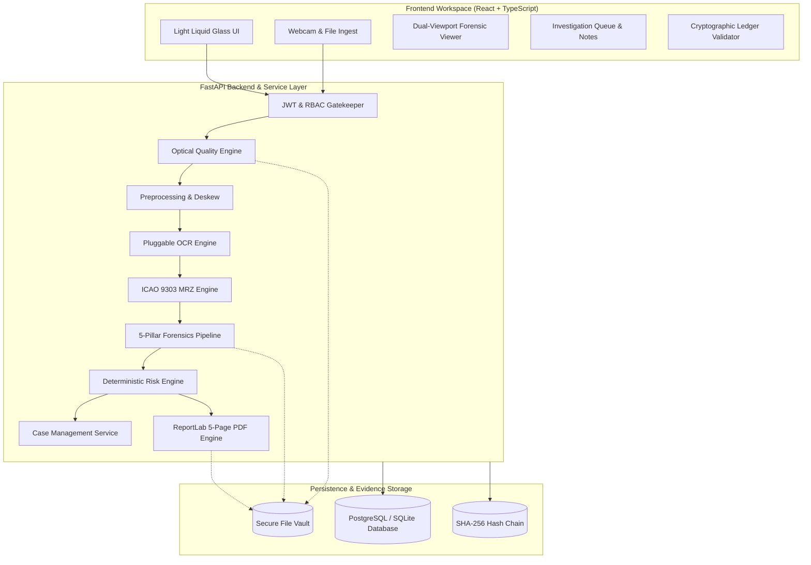

# VERISIGHT — System Architecture & Technical Specifications
## Smart India Hackathon 2026 // Problem Statement 26188 (MHA - SSB)
### AI-Based Fake Identity & Document Screening Platform

---

## 1. Executive Architecture Overview

VERISIGHT is an enterprise-grade, privacy-preserving, explainable identity document screening platform engineered for authorized security officers, border control examiners, and institutional compliance auditors.

The platform follows a decoupled, multi-layered architecture:
1. **Front-End Workspace**: React 18, TypeScript, Tailwind CSS, Framer Motion, Recharts, Lucide Icons, and the Light Liquid Glass design system.
2. **API & Orchestration Tier**: Python FastAPI, Pydantic v2 data models, synchronous thread-pooled database sessions, and role-based access control (RBAC).
3. **Computer Vision & Ingestion Engine**: OpenCV, Pillow, and NumPy for non-destructive pre-flight quality checks, affine rotation, Hough line deskewing, and CLAHE contrast normalization.
4. **Optical Character Recognition (OCR)**: Pluggable OCR Engine abstraction supporting CPU-optimized Tesseract with character-level bounding box confidence scores and graceful offline fallbacks.
5. **MRZ Cryptographic Verification**: Deterministic ICAO Document 9303 TD1, TD2, and TD3 parser with 7-3-1 weight algorithms, composite checksum verification, and VIZ-vs-MRZ cross-field consistency validation.
6. **Multi-Factor Digital Forensics Suite**:
   - Error Level Analysis (ELA) with 8x8 DCT recompression difference mapping and JET heatmap rendering.
   - Deep EXIF and software metadata provenance inspection.
   - High-frequency surface texture and sensor noise variance across spatial grids.
   - Typographic text alignment, baseline linearity, and font pitch verification.
   - Portrait perimeter boundary discontinuity and hard-edge seam detection.
7. **Deterministic Explainable Risk Engine**: Versioned rule system (`VERISIGHT-RULES-v1.2`) enforcing three-tier classification (`CLEAR`, `REVIEW`, `HIGH_RISK`), weighted indicator separation, and anti-correlation de-duplication (preventing poor quality scans from triggering false fraud alarms).
8. **Investigation Center**: Case management queue with faceted filtering, multi-officer threaded notes, priority triage, and audited status transitions.
9. **Tamper-Evident SHA-256 Audit Chain**: Forward-secure, append-only hash-chained ledger storing every ingestion, field modification, risk override, and dossier export, with a live recursive integrity verification endpoint.
10. **Institutional Dossier Generation**: ReportLab automated 5-page PDF export containing credential metadata, quality telemetry, extracted VIZ fields, MRZ checksums, forensic findings, and statutory non-conclusive disclaimers.



---

## 2. Ingestion & Preprocessing Pipeline

### 2.1 Magic Byte Validation
To prevent MIME-spoofing and malicious payload execution, incoming file streams are verified against their true file headers before writing to disk:
- JPEG: `\xFF\xD8\xFF`
- PNG: `\x89PNG\r\n\x1a\n`

### 2.2 Immediate SHA-256 Evidence Hashing
Before any transformation occurs, the raw byte stream is hashed using SHA-256. This cryptographic hash is attached to the `documents` table and written as the genesis hash of the document's audit record. The original unedited file is stored non-destructively in `settings.UPLOAD_DIR`.

### 2.3 Pre-Flight Optical Quality Engine (`quality.py`)
- **Laplacian Sharpness Variance**: Computes $\sigma^2(\nabla^2 I)$. Focus is acceptable when variance $\ge 100.0$.
- **Specular Glare Ratio**: Calculates the percentage of pixels where luminance $L \ge 250$. Flagged when glare $> 5\%$.
- **Mean Brightness**: Grayscale luminance mean (target range 90–200).
- **Estimated DPI**: Derived from physical pixel dimensions against standard ID-1/ID-3 physical dimensions (standard baseline $\ge 300\text{ DPI}$).
- **Rescan Directive**: If blur or glare exceed thresholds, `rescan_recommended = True` is flagged.

### 2.4 Preprocessing Pipeline (`preprocessing.py`)
- **Affine Orientation Rectification**: Rotates images captured at 90°, 180°, or 270°.
- **Hough Line Deskewing**: Probabilistic Hough Transform (`cv2.HoughLinesP`) detects dominant horizontal text lines, computing angle $\theta$ and applying an affine inverse rotation matrix.
- **Contrast Limited Adaptive Histogram Equalization (CLAHE)**: Applied in the $L$ channel of the $LAB$ color space to normalize lighting and recover text in shadowed regions.
- **Bilateral Filtering**: Edge-preserving noise reduction smoothing sensor noise without blurring text glyphs.

---

## 3. Optical Character Recognition & MRZ Engine

### 3.1 OCR Engine Interface (`engines/ocr/`)
The platform implements an abstract base class `BaseOCREngine` defining:
```python
def extract(self, image_path: str) -> OCRResultDTO: ...
```
The active implementation `TesseractOCREngine` extracts text, normalized bounding boxes (`x, y, w, h`), and confidence scores for:
- Document Number, Surname, Given Names, Nationality, Date of Birth, Sex, Expiry Date, and MRZ lines.

### 3.2 ICAO Doc 9303 Verification (`engines/mrz/`)
MRZ characters map to integer values: `<` = 0, `0`–`9` = 0–9, `A`–`Z` = 10–35.
The weighted checksum computes:
$$\text{Checksum} = \left( \sum_{i=0}^{n-1} \text{value}(c_i) \times w_{i \pmod 3} \right) \pmod{10}$$
where weights $w = [7, 3, 1]$.
Verification checks:
1. Document Number Check Digit
2. Date of Birth Check Digit
3. Expiry Date Check Digit
4. Composite Check Digit (covering lines and check digits)
5. VIZ-to-MRZ Cross-Check (verifying printed surface text against machine-readable line encoding).

---

## 4. Multi-Factor Forensic Laboratory

| Forensic Pillar | Algorithm / Technique | Primary Indicator | Limitation & Statutory Caveat |
| :--- | :--- | :--- | :--- |
| **Error Level Analysis (ELA)** | JPEG quality 95 re-save, absolute difference $\Delta = \|I_{\text{orig}} - I_{\text{q95}}\|$, amplified $\times 12$ into JET colormap. | Clustered DCT compression variance $> 60.0$ indicating digital splicing. | ELA indicates compression rate differences. It is an indicative clue, not proof of fraud. |
| **Metadata Inspection** | EXIF parsing via Pillow for software tags (`Software`, `ImageDescription`, `Artist`). | Presence of Photoshop, Canva, GIMP, Paint.NET signatures. | Metadata can be stripped by messaging apps or added by legitimate scanner drivers. |
| **Substrate Texture** | Laplacian high-frequency noise variance across an $8 \times 8$ spatial grid. | Patch variance deviating by $> 3\sigma$ from global substrate baseline. | Guilloche patterns and hologram overlays introduce natural variance. |
| **Typographic Alignment** | Text baseline Hough line extraction and angular variance calculation. | Text lines with angular variance $> 2.5^\circ$ or irregular baseline pitch. | Creased pages or curved scans can mimic baseline drift. |
| **Portrait Boundary** | Sobel perimeter gradient magnitude along portrait border. | Sharp edge gradient magnitude $> 65.0$ indicating hard rectangular paste seam. | Laser-engraved portraits and variable laminate gloss can affect border transitions. |

---

## 5. Explainable Risk Engine (`VERISIGHT-RULES-v1.2`)

### 5.1 Classification Thresholds
- `HIGH_RISK`: Score $\ge 65.0$ OR any triggered rule has `is_critical == True`.
- `REVIEW`: Score $\ge 35.0$ and $< 65.0$, OR `rescan_recommended == True`.
- `CLEAR`: Score $< 35.0$ with zero critical rules triggered.

### 5.2 Correlation De-Duplication
If optical acquisition quality is poor (`rescan_recommended == True`), correlated texture noise and OCR confidence alerts are suppressed to prevent false accusations caused purely by camera glare or blur.

### 5.3 Supervisory Override
Senior Reviewers and Administrators can override risk determinations via `POST /api/v1/risk/{id}/override`. An override requires a mandatory justification string ($\ge 10$ characters) and appends a cryptographically signed entry to the audit log.

---

## 6. Forward-Secure SHA-256 Audit Chain

The audit ledger implements a blockchain-style append-only hash chain:
$$H_0 = 0^{64}$$
$$H_n = \text{SHA-256}\left(H_{n-1} \,\|\, \text{record\_id} \,\|\, \text{event\_type} \,\|\, \text{actor\_id} \,\|\, \text{timestamp} \,\|\, \text{canonical\_metadata}\right)$$

### Verification Endpoint (`GET /api/v1/audit/verify-integrity`)
Iterates from genesis block to current block, verifying:
1. $H_n$ is a valid 64-character hexadecimal digest.
2. $\text{block}[i].\text{prev\_hash} == \text{block}[i-1].\text{current\_hash}$.
If any database row is deleted or modified, the chain break is instantly identified with the exact block ID.

